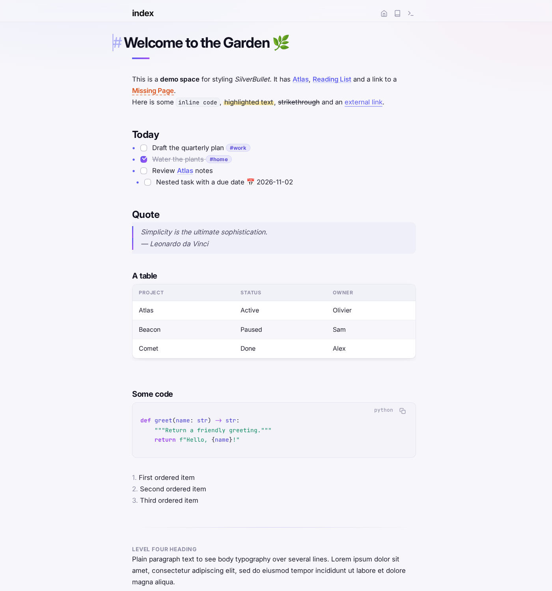
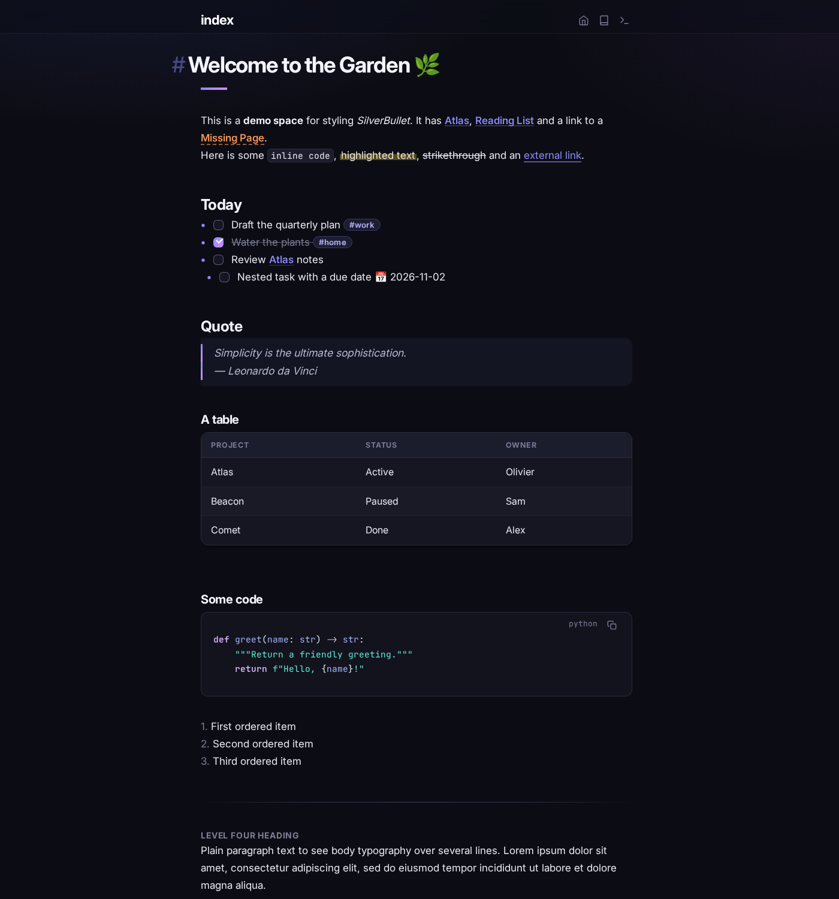
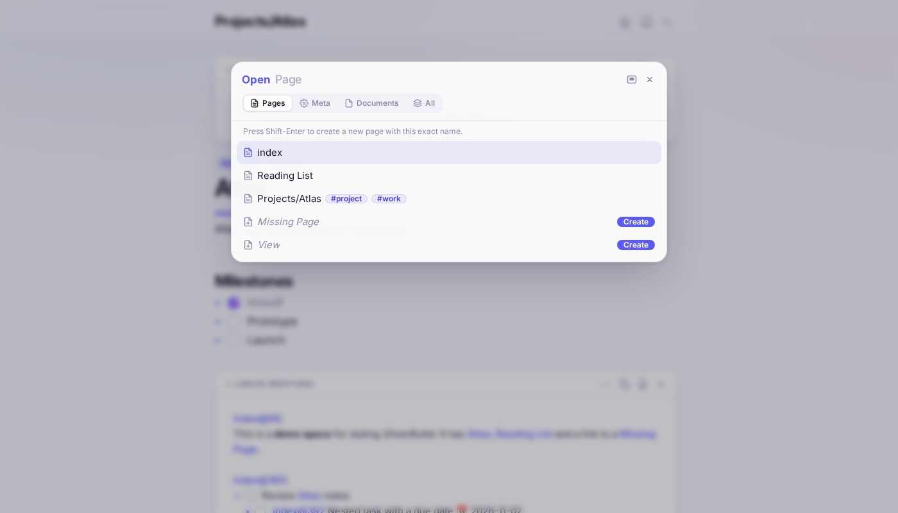
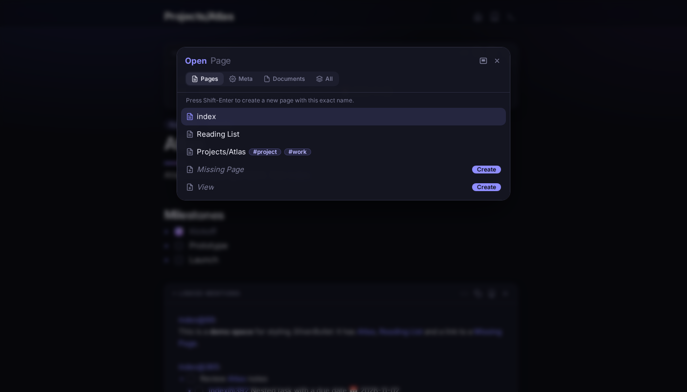
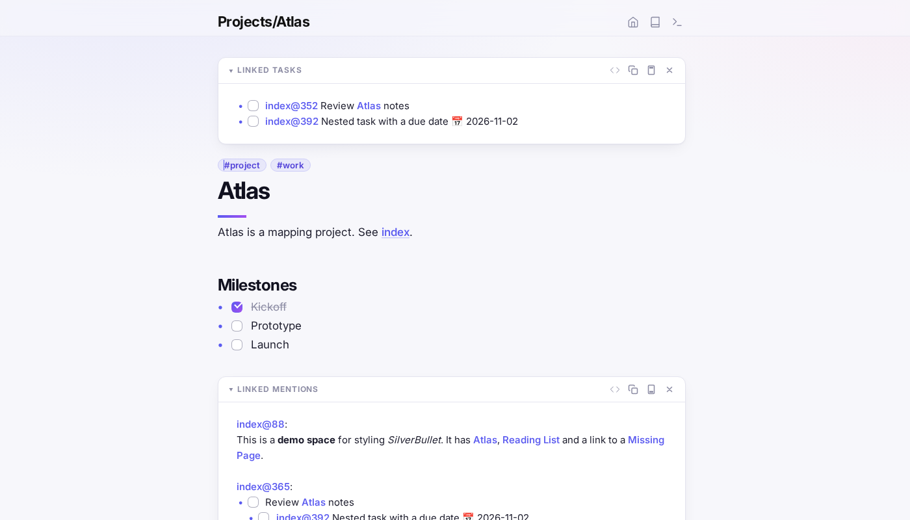
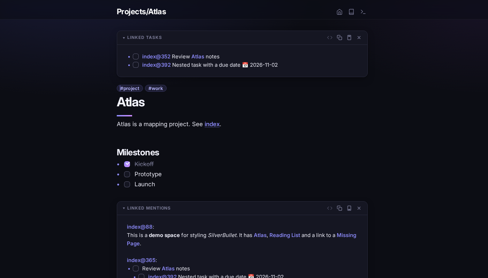
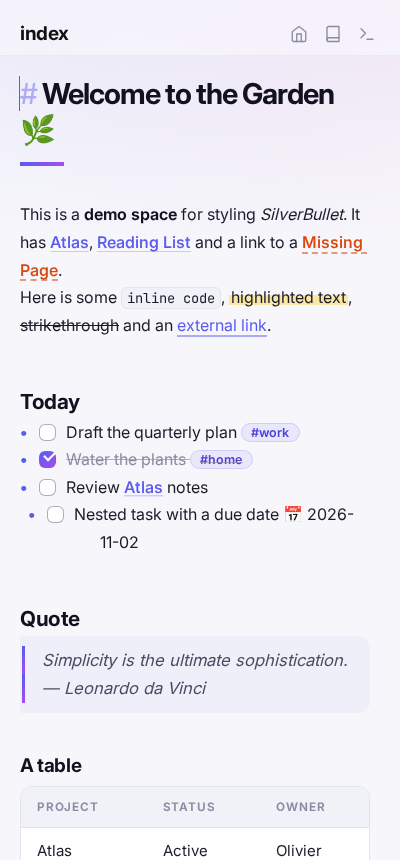
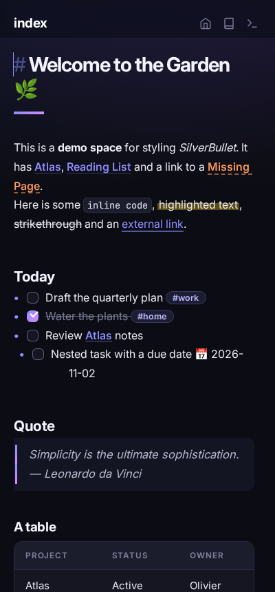
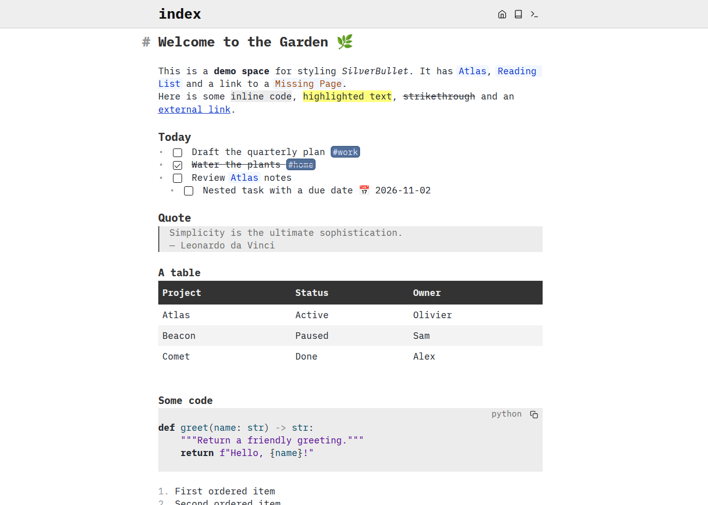

# Aurora — a modern theme for SilverBullet

A polished, modern style for [SilverBullet](https://silverbullet.md) (tested on v2.12).
Inter for prose, JetBrains Mono for code, soft indigo→violet accents, glassy chrome and card‑like blocks — in both light and dark mode.

| Light | Dark |
|-------|------|
|  |  |
|  |  |
|  |  |

<p>
  
  
</p>

<details>
<summary>Before: stock SilverBullet</summary>


</details>

## What it styles

- **Typography** — Inter / JetBrains Mono, tighter heading tracking, gradient accent bar under the H1, uppercase H4 labels
- **Chrome** — frosted‑glass top bar with soft icon buttons, subtle background glow
- **Inline** — underline‑on‑hover wiki links, dashed underline for missing pages, pill hashtags, marker‑pen highlights, bordered inline code
- **Tasks** — custom rounded checkboxes with a gradient tick (also in linked tasks / widgets)
- **Blocks** — code blocks, blockquotes, tables and page widgets (Linked Tasks / Linked Mentions) rendered as rounded cards
- **Page picker & command palette** — rounded glass modal, blurred backdrop, segmented pill tabs, rounded result rows
- **Mobile** — tuned sizes for small screens

## Install

1. Copy [`Aurora.md`](Aurora.md) into your space (e.g. as `Library/Theme/Aurora.md`).
2. Reload SilverBullet. The CSS lives in a `space-style` block and is picked up automatically once the space is indexed.

Fonts are loaded from Google Fonts; offline, it falls back to your system UI and monospace fonts.

### Customise

Everything is driven by a few tokens at the top of the style block — change these to recolour the whole theme:

```css
html {
  --au-accent: #5b5bf0;   /* primary accent */
  --au-accent-2: #a24ef0; /* gradient end */
  --au-bg: #f7f7fb;       /* page background */
  --editor-width: 760px;
}
html[data-theme="dark"] { --au-accent: #8f8dff; /* … */ }
```

## Development

The theme was iterated by running SilverBullet in Docker and screenshotting it headlessly with Playwright.

```bash
# run SilverBullet against the demo space, with the theme mounted in
mkdir -p demo-space/Theme && cp Aurora.md demo-space/Theme/
docker run -d --name sb-theme -p 127.0.0.1:3111:3000 \
  -v "$PWD/demo-space":/space ghcr.io/silverbulletmd/silverbullet:latest

# light/dark × index/page/picker/mobile screenshots into shots/
tools/run.sh v1
```

## License

MIT
